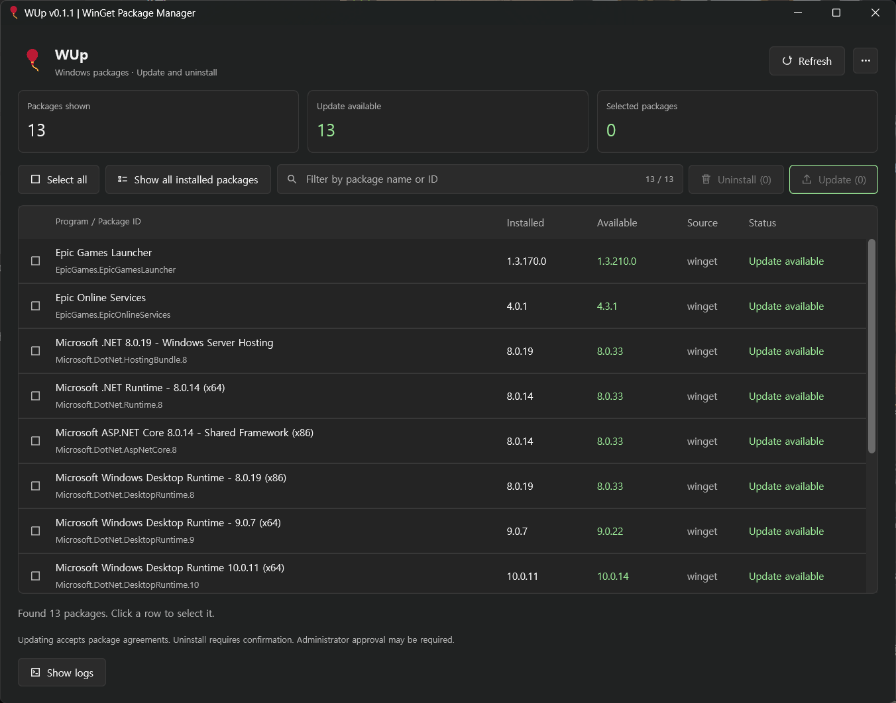

# WUp

[English](README.md) | 한국어

Rust와 GPUI로 만든 가벼운 Windows 패키지 관리자입니다. WinGet을 통해 프로그램을 조회·필터링하고, 선택한 항목을 업데이트하거나 제거할 수 있습니다.



## 주요 기능

- 실행 시 업데이트 가능한 패키지를 자동으로 조회하고, 전체 설치 패키지 목록으로 전환할 수 있습니다.
- 이름이나 ID로 패키지를 필터링하고 선택한 항목만 업데이트합니다.
- 확인창에서 대상을 검토한 후 선택한 프로그램을 제거합니다.
- 하나의 버튼으로 화면에 보이는 패키지를 전체 선택하거나 해제합니다.
- 회전하는 진행 표시와 실행 로그로 작업 상태를 확인합니다.
- 패키지 목록과 로그에 독립적인 스크롤바를 제공하며, 마우스 휠·스크롤바 드래그·트랙 클릭을 지원합니다.
- 코딩 편집기 스타일의 테마 6종, 한국어·영어, 80~120% UI 배율을 지원합니다.
- **… → 앱 정보**에서 버전, 개발자 연락처, GitHub 주소, 커피 후원 링크를 확인할 수 있습니다.
- 탐색기, 작업 표시줄, 시작 메뉴와 설치 프로그램에 풍선 아이콘을 사용합니다.

## 다운로드 및 설치

[GitHub Releases](https://github.com/chanhwahong/wup/releases)에서 최신 설치 파일을 내려받으세요.

| 파일 | 용도 |
| --- | --- |
| `WUp-<version>-windows-x64.exe` | MSI를 내장한 EXE 설치 마법사입니다. 더블클릭하여 설치합니다. |
| `WUp-<version>-windows-x64.msi` | 독립적으로 실행할 수 있는 Windows Installer 패키지입니다. |
| `SHA256SUMS.txt` | EXE·MSI 파일의 SHA-256 체크섬입니다. |
| `build-info.json` | 버전, 커밋, 워크플로 빌드 정보입니다. |

두 설치 파일 모두 현재 사용자 계정의 `%LOCALAPPDATA%\Programs\WUp`에 설치하고 시작 메뉴 바로가기를 만듭니다. EXE에는 MSI가 포함되어 있어 별도로 내려받지 않습니다. EXE로 설치하면 앱 목록이 중복되지 않도록 내부 MSI 항목을 숨깁니다.

더 높은 버전의 MSI는 기존 설치를 교체하며, 낮은 버전의 설치는 차단됩니다. EXE 번들도 고정된 업그레이드 식별자를 사용합니다. 테마·언어·배율 설정은 설치 파일과 별도 경로에 저장됩니다. 포터블 실행 파일은 설치 프로그램이 자동으로 제거하지 않습니다.

EXE 설치 프로그램은 설치·수정·복구·제거·진행 화면의 WUp 제목 아래에 **Windows packages Update and uninstall** 문구를 표시합니다.

실행 환경:

- GPU 드라이버가 정상적으로 설치된 Windows 10/11 x64.
- Microsoft Store의 **앱 설치 관리자(App Installer)**에 포함된 WinGet.

## 사용 방법

1. WUp을 열고 패키지 조회가 끝날 때까지 기다립니다. 처음에는 아무 항목도 선택되지 않습니다.
2. 행을 클릭하거나 **전체 선택 / 전체 해제** 버튼으로 패키지를 선택합니다.
3. **업데이트 (N)**를 눌러 새 버전이 있는 선택 항목을 업데이트합니다.
4. **전체 설치 패키지 보기**를 켜면 설치된 프로그램을 조회합니다. 모드를 전환하면 목록을 다시 불러오고 선택을 초기화합니다.
5. 프로그램을 제거하려면 항목을 선택하고 **제거 (N)**를 누릅니다. 확인창의 이름·ID·버전을 검토한 후 제거를 확인합니다.
6. **현재 항목 완료 후 중단**으로 현재 작업이 끝난 뒤 대기 중인 작업을 취소할 수 있습니다.
7. 작업 후 새로고침하여 설치 상태를 다시 조회합니다. 제거된 프로그램은 다음 새로고침 전까지 제거 완료 상태로 표시됩니다.

한 항목의 설치가 실패해도 다음 대기 항목을 계속 처리합니다. 실패한 항목은 다시 선택하여 재시도할 수 있습니다. 업데이트 시 패키지 약관에 동의하는 옵션을 사용합니다. 개별 설치 프로그램이 UAC 관리자 승인을 요청할 수 있으며, 권한 문제로 작업이 실패하면 로그를 확인하세요.

### 패키지 필터

필터 입력창은 선택·업데이트·제거 버튼과 같은 줄에 있습니다.

- 대소문자 구분 없이 패키지 이름 또는 ID를 검색합니다.
- 공백으로 단어를 나누면 모든 단어가 이름이나 ID 어딘가에 포함되어야 합니다.
- 오른쪽에 검색 결과 / 전체 패키지 수를 표시하며, **X** 버튼으로 필터를 지웁니다.
- 한글 IME 입력, 텍스트 선택, 이동 키, **Ctrl+A/C/V/X**를 지원합니다.

필터는 업데이트 목록과 전체 설치 목록 모두에 적용됩니다. 전체 선택·해제, 업데이트·제거 작업은 보이는 항목에만 적용됩니다. 필터를 바꿔 숨겨지는 항목은 선택을 해제합니다. 새로고침하거나 목록 모드를 바꿔도 필터 문자열은 유지합니다. 작업 중이거나 제거 확인창·앱 정보 창이 열려 있으면 입력을 잠시 비활성화합니다.

### 실행 로그

**실행 로그 보기**로 출력을 확인하고 **로그 복사**로 클립보드에 복사할 수 있습니다. 로그에는 별도의 스크롤바가 있습니다. 일반적인 새로고침·목록 조회 출력은 기록하지 않으며, 조회 오류와 업데이트·제거 로그는 유지합니다.

메모리에는 최근 로그 최대 1,000개를 보관하고, 화면에는 최신 120개를 표시합니다. 앱이 생성하는 메시지는 선택한 언어로 표시합니다. 패키지 이름·ID와 WinGet·설치 프로그램의 원본 출력은 번역하지 않습니다.

## 테마와 언어

오른쪽 위 **…** 메뉴를 여세요. 항목에 마우스를 올리거나 클릭하면 서브메뉴가 열립니다.

| 설정 | 선택 항목 |
| --- | --- |
| 테마 | Charcoal Green, Dracula, One Dark, Nord, Tokyo Night, GitHub Light |
| 언어 | 한국어, English |
| UI 배율 | 80~120%, 5% 단위 조절, 100%로 초기화 |

기본 테마는 **Tokyo Night**, 앱의 기본 언어는 **한국어**입니다. 저장소의 기본 README는 영어입니다. 테마나 언어를 바꿔도 진행 중인 패키지 작업을 다시 시작하거나 목록을 재조회하지 않습니다.

테마·언어·배율은 `%LOCALAPPDATA%\Wup\theme.txt`, `language.txt`, `scale.txt`에 저장합니다. `LOCALAPPDATA`가 없으면 `APPDATA`를 사용합니다. 설정이 없거나 잘못된 경우 기본값을 사용하며, 저장 실패는 로그에 표시합니다.

현재 100%는 초기 버전의 90% 크기를 기준으로 합니다. 기존 배율 설정은 자동으로 변환합니다.

## 소스 빌드

준비 사항:

- MSVC 도구 체인을 사용하는 Rust stable.
- **C++를 사용한 데스크톱 개발**과 Windows SDK(`fxc.exe` 포함)가 설치된 Visual Studio Build Tools.
- 최초 의존성 다운로드를 위한 인터넷 연결.
- 설치 파일을 생성할 경우 .NET 8 SDK.

도구를 확인합니다.

```powershell
rustc --version
cargo --version
winget --version
```

앱을 실행합니다.

```powershell
cargo run --release
```

앱 실행 파일은 `target\release\wup.exe`입니다. Release 빌드는 별도의 콘솔 창을 띄우지 않습니다. 최초 빌드는 GPUI와 그래픽 의존성을 컴파일하므로 시간이 걸릴 수 있습니다.

실제 패키지를 조회하거나 변경하지 않고 UI를 확인하려면 다음 명령을 사용합니다.

```powershell
cargo run --release -- --demo
```

### 로컬 설치 파일 생성

EXE 설치 프로그램과 MSI를 빌드합니다.

```powershell
dotnet tool restore
powershell -NoProfile -ExecutionPolicy Bypass -File .\scripts\build.ps1 -Installer
```

스크립트는 서식 검사와 핵심 테스트를 실행하고, 잠금 파일의 의존성으로 Release를 빌드한 뒤 MSI와 WiX Burn EXE 설치 프로그램을 생성합니다. EXE 내부에 동일한 MSI가 포함되는지도 검증합니다. WiX CLI와 Bal 확장은 **4.0.6**으로 고정합니다. 결과는 `dist\`에 생성합니다.

로컬 포터블 앱만 필요하면 `-Installer`를 생략하세요. `dist\wup.exe`를 생성하며, 버전이 붙은 EXE 설치 파일을 덮어쓰지 않습니다. 앱 자체의 실행 파일과 릴리스의 EXE 설치 파일은 서로 다릅니다.

### 테스트

```powershell
cargo fmt --all -- --check
cargo test
powershell -NoProfile -ExecutionPolicy Bypass -File .\scripts\test-core.ps1
powershell -NoProfile -ExecutionPolicy Bypass -File .\scripts\test-build-version.ps1
powershell -NoProfile -ExecutionPolicy Bypass -File .\scripts\test-publish-release.ps1
```

독립 실행 핵심 테스트는 표 파싱, 명령 인자, 필터, 설정, 스크롤바, 픽셀 정렬을 검증합니다. 릴리스 게시 테스트는 가짜 GitHub CLI를 사용하며 실제로 게시하지 않습니다.

실제 GPUI 렌더링 검사는 다음과 같이 실행합니다.

```powershell
.\target\release\wup.exe --smoke-test-menus
```

데모 데이터로 필터 입력·보이는 항목 선택·메뉴·앱 정보·배율·소수점 스크롤을 검사한 후 종료합니다. WinGet을 실행하거나 설정을 저장하지 않습니다. 렌더링 검사가 실제 마우스·키보드 조작이나 실제 설치 프로그램 테스트를 대신하지는 않습니다.

## GitHub Actions와 릴리스

브랜치에 푸시할 때마다 **Windows build**가 실행됩니다. 로컬 커밋만으로는 GitHub Actions가 실행되지 않으므로 원격 저장소에 푸시해야 합니다. 여러 커밋을 한 번에 푸시하면 마지막 커밋을 빌드합니다. **Actions → Windows build → Run workflow**에서 수동 실행할 수도 있습니다.

빌드가 성공하면 다음과 같이 처리합니다.

- EXE·MSI 설치 파일, 체크섬, 빌드 정보를 워크플로 아티팩트로 올리고 30일 동안 보관합니다.
- 별도 작업에서 실제 빌드한 커밋에 `v0.1.2` 같은 버전 태그를 만들고 GitHub Release에 파일을 첨부합니다.
- 기본 브랜치는 정식 릴리스, 다른 브랜치는 사전 릴리스로 게시합니다.
- 초안 상태에서 파일 업로드를 마친 후 게시합니다. 재실행하면 초안을 이어 처리하고, 이미 게시된 파일은 유지합니다.
- 릴리스 작업에만 `contents: write` 권한을 부여하며 GitHub 기본 토큰을 사용합니다. 별도 비밀키는 필요하지 않습니다. 저장소 규칙에서 해당 토큰의 태그·릴리스 생성을 허용해야 합니다.
- 브랜치 푸시만 감지하므로 생성된 태그 때문에 빌드가 다시 실행되지는 않습니다.

### 자동 버전 증가

버전은 **기준 패치 번호 + `github.run_number`**로 계산합니다. 저장소의 기준 버전이 `0.1.1`이면 첫 실행은 `0.1.2`, 두 번째는 `0.1.3`이 됩니다.

앱 정보 창, Windows EXE 버전 리소스, MSI 버전, 파일 이름에 동일한 생성 버전을 사용합니다. 창 제목은 버전 없이 **WUp | WinGet Package Manager**로 표시합니다.

버전 변경은 CI 작업 폴더에만 적용하며 저장소에 다시 커밋하지 않습니다. 같은 실행을 재시도하면 버전은 유지하고 아티팩트 이름에 시도 번호를 붙입니다. 수동 실행이나 실패한 실행 때문에 버전 번호가 건너뛸 수 있습니다.

같은 버전 계열에서는 저장소의 기준 패치 번호와 워크플로 파일 경로를 유지하세요. MSI 범위를 검사하며, 주·부 버전은 255, 생성된 패치 번호는 65535를 넘을 수 없습니다. 패치 범위를 초과하면 부 버전을 올리고 기준 패치를 초기화해야 합니다. 워크플로 실행 번호는 계속 증가합니다.

`scripts/set-build-version.ps1 -BuildNumber N`은 두 Cargo 파일을 수정하며, 새로 체크아웃한 작업 폴더에서 사용하도록 만들어졌습니다.

`.github/`, `.config/`, `installer/`, `scripts/`, `src/`, `assets/`, `build.rs` 등 소스·리소스·고지문·설정 파일을 함께 커밋하세요. `target/`, `dist/`, `.codex/`, `.wix/`, 전송 도우미 폴더는 커밋하지 않습니다.

## WinGet 호출 방식

목록 조회는 패키지를 업데이트하지 않습니다.

```powershell
winget upgrade --accept-source-agreements --disable-interactivity
winget list --accept-source-agreements --disable-interactivity
```

선택한 항목마다 정확한 ID를 지정하며, 셸 문자열 조합이나 `--all` 작업은 사용하지 않습니다. 아래 자리표시자는 실제 패키지 정보로 바꿔 주세요.

```powershell
winget upgrade --id <package-id> --exact --source <source> --silent --accept-source-agreements --accept-package-agreements --disable-interactivity
winget uninstall --id <package-id> --exact --version <installed-version> --source <source> --silent --accept-source-agreements --disable-interactivity
```

원본이 없는 로컬 프로그램을 제거할 때는 `--source`를 생략하고, 설치 버전을 아는 경우에만 `--version`을 포함합니다. `--all-versions`, `--purge`, `--force`는 사용하지 않습니다.

### 제한 사항

- 한국어·영어 WinGet 텍스트 표를 지원하고 열의 표시 폭으로 파싱합니다. 특수한 이름·이모지·향후 출력 형식 변경에는 추가 대응이 필요할 수 있습니다. 잘린 ID는 표시하되 작업 대상으로 사용할 수 없습니다.
- 목록은 일반적인 `winget upgrade`·`winget list` 결과이며 Windows의 모든 시스템 구성 요소를 나열하지는 않습니다. 설치 버전을 알 수 없는 패키지의 업데이트를 별도로 포함하지 않습니다.
- 사용자가 업데이트·제거 버튼을 눌러야 패키지를 변경합니다. 개별 설치 프로그램의 동작과 승인 요구는 유지됩니다.
- 자동 재부팅을 요청하거나 명시적으로 허용하는 옵션은 사용하지 않습니다. 재시작 필요 여부는 설치 로그와 종료 코드를 확인하세요.
- 중단은 현재 항목이 끝난 뒤 적용됩니다. 작업 중 창 닫기는 제한하고, 남은 대기 작업의 중단을 요청합니다.
- 조회 제한 시간은 3분, 개별 작업은 1시간입니다. 시간 초과 시 WinGet을 종료하지만 자식 설치 프로그램은 계속 실행될 수 있습니다.

## 프로젝트 구성

| 경로 | 역할 |
| --- | --- |
| `src/main.rs` | GPUI 화면, 선택, 작업 큐, 로그, 메뉴, 앱 정보 |
| `src/filter_input.rs` | 한 줄 입력, IME 조합, 클립보드, 커서·선택 |
| `src/package_filter.rs` | 대소문자를 구분하지 않는 검색과 테스트 |
| `src/winget.rs` | WinGet 실행, 표 파싱, 인자 구성과 테스트 |
| `src/scrollbar.rs` | 스크롤바 크기·위치·드래그 |
| `src/icons.rs` | 단색 벡터 아이콘과 진행 표시 |
| `src/theme.rs`, `src/i18n.rs`, `src/ui_scale.rs` | 테마, 번역, 설정, UI 배율 |
| `src/pixel_snap.rs` | 행과 구분선의 픽셀 정렬 |
| `build.rs` | Windows 아이콘·버전 리소스 |
| `installer/` | MSI, EXE 번들, 공통 설치 테마·문구 |
| `scripts/` | 빌드, 패키징, 버전 증가, 릴리스 게시, 검증 |

GPUI는 `0.2.2`로 고정하며 `Cargo.lock`을 커밋합니다. 조회와 패키지 작업은 작업 스레드에서 실행하고 채널로 결과를 GPUI에 전달합니다.

## 개발자·후원·고지

- 개발자: [chanhwahong@gmail.com](mailto:chanhwahong@gmail.com)
- GitHub: [chanhwahong/wup](https://github.com/chanhwahong/wup)
- [커피 한 잔 후원하기](https://ko-fi.com/chanhwahong)

풍선 그림은 Twitter, Inc.와 기여자들의 Twemoji이며 CC BY 4.0으로 제공됩니다. 입력 컴포넌트는 Apache-2.0의 GPUI 예제를, 설치 테마·문구는 MS-RL의 WiX 리소스를 수정하여 사용합니다. [THIRD-PARTY-NOTICES.txt](THIRD-PARTY-NOTICES.txt)와 [assets/](assets/)의 라이선스 파일을 확인하세요.

## 참고 문서

- [GPUI 0.2.2](https://docs.rs/gpui/0.2.2/gpui/)
- [WinGet upgrade](https://learn.microsoft.com/windows/package-manager/winget/upgrade)
- [WinGet list](https://learn.microsoft.com/windows/package-manager/winget/list)
- [WinGet uninstall](https://learn.microsoft.com/windows/package-manager/winget/uninstall)
