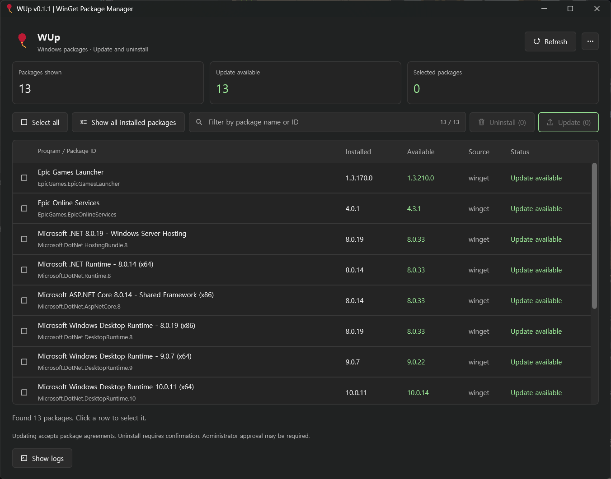

# WUp

English | [한국어](README.ko.md)

A lightweight Windows package manager built with Rust and GPUI. Browse, filter, update, and uninstall applications through WinGet.



## Features

- Automatically load available updates on startup, or switch to the full installed-package list.
- Filter packages by name or ID, then update only the selected packages.
- Uninstall selected programs after reviewing a confirmation dialog.
- Select or deselect all visible packages with one button.
- Follow running operations with an animated progress ring and execution logs.
- Scroll the package list and logs independently using the mouse wheel, scrollbar thumb, or track.
- Choose from six editor-inspired themes, Korean or English, and an 80–120% UI scale.
- Open **… → About** for the app version, developer contact, GitHub repository, and coffee donation link.
- Use the balloon application icon in Explorer, the taskbar, Start menu, and installer.

## Download and install

Download the latest packages from [GitHub Releases](https://github.com/chanhwahong/wup/releases).

| File | Purpose |
| --- | --- |
| `WUp-<version>-windows-x64.exe` | EXE setup wizard with the MSI embedded; double-click to install. |
| `WUp-<version>-windows-x64.msi` | Standalone Windows Installer package. |
| `SHA256SUMS.txt` | SHA-256 checksums for the EXE and MSI. |
| `build-info.json` | Version, commit, and workflow build details. |

Both installers install WUp for the current user under `%LOCALAPPDATA%\Programs\WUp` and create a Start menu shortcut. The EXE includes the MSI and does not need to download it separately. When installed through the EXE, the internal MSI entry is hidden to avoid duplicate installed-app entries.

Newer MSI versions replace the previous installation; lower versions are blocked. The EXE bundle also keeps a stable upgrade identity. Theme, language, and scale preferences are stored separately from the installed files. A portable copy is not automatically removed by the installer.

The EXE setup displays **Windows packages Update and uninstall** beneath the WUp heading on installation, maintenance, repair, uninstall, and progress pages.

Runtime requirements:

- Windows 10/11 x64 with a working GPU driver.
- WinGet, included with **App Installer** from the Microsoft Store.

## Usage

1. Open WUp and wait for the package query to finish. No packages are selected initially.
2. Click rows to select packages, or use **Select all / Deselect all**.
3. Click **Update (N)** to update selected packages with an available update.
4. Enable **Show all installed packages** to browse installed programs. Switching modes reloads the list and clears selection.
5. To remove programs, select them, click **Uninstall (N)**, review the names, IDs, and versions, then confirm.
6. Use **Stop after current** to cancel queued work after the current operation finishes.
7. Refresh after operations to query the installed state again. Removed programs remain marked as uninstalled until the next refresh.

An installer failure does not stop later queued items. Failed packages can be selected again and retried. Updating accepts package agreements. Individual installers may request administrator approval through UAC; check the logs if an operation fails because of permissions.

### Package filter

The filter field shares the toolbar with selection and package actions.

- Match package names or IDs without case sensitivity.
- Separate words with spaces to require every word to match somewhere in the name or ID.
- See matching / total package counts on the right; click **X** to clear the filter.
- Use Korean IME input, text selection, navigation keys, and **Ctrl+A/C/V/X**.

Filtering applies to both list modes. Select all / deselect all, update, and uninstall operate on visible packages. Changing the filter deselects packages that become hidden. Refreshing or switching modes keeps the filter text. Editing is paused while an operation or confirmation/About dialog is active.

### Logs

Use **Show logs** to view execution output and **Copy logs** to copy it. The log panel has its own scrollbar. Ordinary refresh/query output is omitted; query errors and update/uninstall logs remain available.

WUp retains up to 1,000 recent log entries in memory and displays the latest 120. App-generated messages follow the selected language. Package names, IDs, and raw WinGet/installer output are preserved.

## Appearance and language

Open the **…** menu at the top right. Hover over or click an item to open its submenu.

| Setting | Options |
| --- | --- |
| Theme | Charcoal Green, Dracula, One Dark, Nord, Tokyo Night, GitHub Light |
| Language | 한국어, English |
| UI scale | 80–120% in 5% steps; 100% resets the scale |

The default theme is **Tokyo Night** and the default app language is **Korean**. This repository's default README is English. Changing appearance or language does not restart package operations or reload the list.

Theme, language, and scale are saved in `%LOCALAPPDATA%\Wup\theme.txt`, `language.txt`, and `scale.txt`. If `LOCALAPPDATA` is unavailable, WUp uses `APPDATA`. Missing or invalid preferences fall back to defaults; save failures are reported in the logs.

The 100% scale uses the earlier 90% size as its baseline. Legacy scale preferences are migrated automatically.

## Build from source

Requirements:

- Rust stable with the MSVC toolchain.
- Visual Studio Build Tools with **Desktop development with C++** and a Windows SDK, including `fxc.exe`.
- Internet access for the first dependency download.
- .NET 8 SDK for installer packaging only.

Verify the tools:

```powershell
rustc --version
cargo --version
winget --version
```

Run the app:

```powershell
cargo run --release
```

The app executable is `target\release\wup.exe`. Release builds do not open a separate console window. The first build can take time because GPUI and graphics dependencies must compile.

To preview the UI without querying or changing real packages:

```powershell
cargo run --release -- --demo
```

### Local packaging

Build the EXE installer and MSI:

```powershell
dotnet tool restore
powershell -NoProfile -ExecutionPolicy Bypass -File .\scripts\build.ps1 -Installer
```

The script checks formatting, runs the core tests, builds with the locked dependencies, creates the MSI and WiX Burn EXE installer, and verifies that the EXE embeds the exact MSI. WiX CLI and the Bal extension are pinned to **4.0.6**. Output is written to `dist\`.

For a local portable app only, omit `-Installer`; this produces `dist\wup.exe` without overwriting the versioned EXE installer. The raw app executable is different from the release setup EXE.

### Tests

```powershell
cargo fmt --all -- --check
cargo test
powershell -NoProfile -ExecutionPolicy Bypass -File .\scripts\test-core.ps1
powershell -NoProfile -ExecutionPolicy Bypass -File .\scripts\test-build-version.ps1
powershell -NoProfile -ExecutionPolicy Bypass -File .\scripts\test-publish-release.ps1
```

The standalone core tests cover parsing, command arguments, filtering, preferences, scrollbars, and pixel snapping. Release publishing tests use a mock GitHub CLI and do not publish anything.

For the real GPUI rendering smoke check:

```powershell
.\target\release\wup.exe --smoke-test-menus
```

This checks filter editing, visible-only selection, menus, About, multiple scales, and fractional scrolling using demo data, then exits. It does not invoke WinGet or save preferences. Rendering checks do not replace manual mouse/keyboard testing or tests with real installers.

## GitHub Actions and releases

Every branch push starts **Windows build**. A local commit alone does not trigger GitHub Actions; push it to the remote. A push containing several commits builds its latest commit. Manual runs are available under **Actions → Windows build → Run workflow**.

After a successful build:

- EXE and MSI installers, checksums, and build metadata are uploaded as workflow artifacts, retained for 30 days.
- A separate job creates a version tag such as `v0.1.2` for the exact built commit and attaches the packages to a GitHub Release.
- Default-branch builds create normal releases; other branches create prereleases.
- Assets upload to a draft before publication. Retries resume drafts and preserve already-published files.
- Only the release job receives `contents: write`; it uses GitHub's built-in token. No extra secret is needed. Repository rules must allow that token to create tags and releases.
- Generated tags do not trigger another build because the workflow listens to branch pushes.

### Automatic versioning

The generated version uses **base patch + `github.run_number`**. With a checked-in base of `0.1.1`, run 1 produces `0.1.2`, run 2 produces `0.1.3`, and so on.

About, Windows EXE version resources, MSI version, and package filenames use the generated version. The window title remains **WUp | WinGet Package Manager**, without a version.

Version changes exist only in the CI checkout; they are not committed back to the repository. A rerun keeps its original version, while artifact names include the attempt number. Manual and failed runs can leave gaps in the sequence.

Keep the checked-in base patch and workflow file path stable within a version line. MSI limits are checked before writing: major/minor must not exceed 255 and the generated patch must not exceed 65535. If the patch would overflow, increase the minor version and reset the base patch; the workflow counter continues.

`scripts/set-build-version.ps1 -BuildNumber N` modifies both Cargo files and is intended for a fresh checkout.

Commit source, assets, notices, and configuration, including `.github/`, `.config/`, `installer/`, `scripts/`, `src/`, `assets/`, and `build.rs`. Do not commit `target/`, `dist/`, `.codex/`, `.wix/`, or transfer-helper folders.

## How WinGet is used

Queries do not update any packages:

```powershell
winget upgrade --accept-source-agreements --disable-interactivity
winget list --accept-source-agreements --disable-interactivity
```

Each selected package is processed by its exact ID, without shell interpolation or an `--all` operation. Replace the placeholders below with actual package details.

```powershell
winget upgrade --id <package-id> --exact --source <source> --silent --accept-source-agreements --accept-package-agreements --disable-interactivity
winget uninstall --id <package-id> --exact --version <installed-version> --source <source> --silent --accept-source-agreements --disable-interactivity
```

Uninstall omits `--source` for local programs without a source and includes `--version` only when the installed version is known. WUp does not use `--all-versions`, `--purge`, or `--force`.

### Limitations

- English and Korean WinGet text tables are supported. Column display widths are parsed; unusual names, emoji, and future WinGet output changes may need additional handling. Truncated IDs are shown but cannot be acted on.
- The lists reflect normal `winget upgrade` / `winget list` output, not every Windows system component. WUp does not opt into updates with unknown versions.
- Only the user's update/uninstall actions start package changes. Individual installers retain their own behavior and approval requirements.
- WUp does not request an automatic reboot or explicitly allow one. Check installer logs and exit codes for restart requirements.
- Stopping takes effect after the current item. Closing during an operation is blocked and requests that remaining queued work stop.
- Queries time out after 3 minutes; an operation times out after 1 hour. WUp stops WinGet on timeout, but a child installer may keep running.

## Project structure

| Path | Purpose |
| --- | --- |
| `src/main.rs` | GPUI views, selection, operation queue, logs, menus, About |
| `src/filter_input.rs` | Single-line input, IME composition, clipboard, cursor and selection |
| `src/package_filter.rs` | Case-insensitive package matching and tests |
| `src/winget.rs` | WinGet processes, parsing, arguments, and tests |
| `src/scrollbar.rs` | Scrollbar geometry and dragging |
| `src/icons.rs` | Monochrome vector icons and progress ring |
| `src/theme.rs`, `src/i18n.rs`, `src/ui_scale.rs` | Themes, translations, preferences, UI scale |
| `src/pixel_snap.rs` | Pixel-aligned rows and separators |
| `build.rs` | Windows icon and version resources |
| `installer/` | MSI, EXE bundle, shared setup theme and localization |
| `scripts/` | Build, packaging, versioning, release publishing, and checks |

GPUI is pinned to `0.2.2`; `Cargo.lock` is committed. Queries and package operations run on worker threads, with results delivered to GPUI through channels.

## Contact, support, and notices

- Developer: [chanhwahong@gmail.com](mailto:chanhwahong@gmail.com)
- GitHub: [chanhwahong/wup](https://github.com/chanhwahong/wup)
- [Buy me a coffee](https://ko-fi.com/chanhwahong)

The balloon artwork is from Twemoji by Twitter, Inc. and other contributors, licensed under CC BY 4.0. The input component adapts a GPUI example under Apache-2.0; the setup theme/localization adapts WiX resources under MS-RL. See [THIRD-PARTY-NOTICES.txt](THIRD-PARTY-NOTICES.txt) and the license files in [assets/](assets/).

## References

- [GPUI 0.2.2](https://docs.rs/gpui/0.2.2/gpui/)
- [WinGet upgrade](https://learn.microsoft.com/windows/package-manager/winget/upgrade)
- [WinGet list](https://learn.microsoft.com/windows/package-manager/winget/list)
- [WinGet uninstall](https://learn.microsoft.com/windows/package-manager/winget/uninstall)
